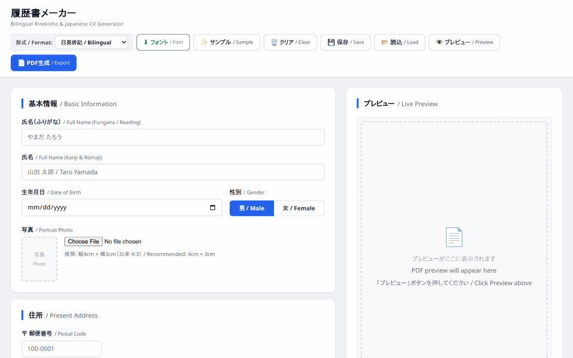

# 履歴書 (Rirekisho) Maker — Bilingual Japanese & English CV Generator

A modern, 100% client-side Japanese curriculum vitae (履歴書 / Rirekisho) web app built with **pure JavaScript, HTML5, and CSS3**.

**Zero backend required.** Runs in any browser, works offline, and can be hosted anywhere (GitHub Pages, Cloudflare Pages, Vercel, Netlify, or standard static web hosting).

Renders pixel-accurate, standard JIS-format A4 履歴書 sheets with **bilingual (Japanese & English side-by-side)** support, real-time typing preview, photo embedding, automatic Japanese era (和暦) conversion, and one-click PDF export.

---



---

## ✨ Features

- **100% Pure Client-Side (Zero Server Required)**:
  - Runs directly in the browser with zero backend installation or server dependencies.
  - Can be hosted on any static hosting (GitHub Pages, Cloudflare Pages, Netlify, Vercel, S3) or opened locally.
- **Instant Real-Time Preview (0ms Latency)**:
  - High-fidelity DOM renderer replicates the JIS standard A4 sheet (`210mm × 297mm`).
  - As you type, the resume preview updates instantly.
  - Interactive zoom controls (`-`, `+`, `Fit to Width`) and sticky split-screen view.
- **Bilingual (日英併記) & Japanese-Only (日本語のみ) Toggle**:
  - Switch with one click between bilingual Japanese/English side-by-side labels and standard Japanese.
  - Supports international job seekers, bilingual applications, and traditional domestic submissions.
- **Dual PDF Export Options**:
  - **1-Click PDF Download**: Export standard A4 PDF directly using bundled client-side `html2pdf.js`.
  - **Native Browser Print**: Click "印刷 / Print" for crisp, vector-grade PDF output via browser print preview (`@media print`).
- **Automatic Japanese Era (和暦) Conversion**:
  - Automatically calculates and formats Western years (西暦) into Japanese eras (令和, 平成, 昭和, 大正, 明治).
  - Automatically computes exact age (`満○歳 / Age: ○`) from the birth date.
- **Draft Autosave & JSON Import/Export**:
  - Automatically saves drafts to `localStorage` so you never lose your progress on page refresh.
  - Export and import form data as `.json` files to manage multiple resume versions.
- **Photo Upload**: Supports portrait photo upload with preview, auto-centering, and removal.
- **Dynamic Rows**: Easily add or remove entries for Education (学歴), Work History (職歴), and Licenses/Certifications (免許・資格).
- **One-Click Bilingual Sample Data**: "✨ サンプル / Sample" button pre-fills the form with a complete, realistic bilingual profile for quick testing.

---

## 🚀 How to Run & Deploy

### Option 1: Open Locally in Browser (Fastest)
Simply double-click or open `index.html` in your favorite web browser (Chrome, Safari, Edge, Firefox):
```bash
# Linux
xdg-open index.html

# macOS
open index.html

# Windows
start index.html
```

### Option 2: Run with Any Local Static Server
```bash
# Using Python's built-in static HTTP server
python3 -m http.server 8080

# Or using Node.js npx serve
npx serve .
```
Then open `http://localhost:8080` in your browser.

### Option 3: Deploy to Web Hosting (GitHub Pages, Cloudflare Pages, Vercel, Netlify)
Since this is a 100% static project, deployment takes just seconds:

- **GitHub Pages**:
  1. Push this repository to GitHub.
  2. Go to **Settings > Pages**.
  3. Under **Branch**, select `main` (root) and click **Save**.
  4. Your app is live at `https://<your-username>.github.io/<repo-name>/`!

- **Cloudflare Pages / Vercel / Netlify**:
  - Connect your repository.
  - Set build command to empty (none required) and publish directory to `.` (root).

---

## 📁 Project Structure

```
cv-maker/
├── index.html             # Standalone static web application entrypoint
├── css/
│   └── style.css          # Responsive app layout, A4 JIS sheet styles & print rules
├── js/
│   ├── era_converter.js   # Pure JS Western (西暦) ↔ Japanese Era (和暦) conversion
│   ├── rirekisho_render.js# Pure JS DOM JIS-standard A4 sheet renderer (Bilingual / JP)
│   ├── app.js             # Form data binding, localStorage autosave, zoom & export logic
│   └── vendor/
│       └── html2pdf.bundle.min.js  # Vendored client-side PDF generator (offline-ready)
├── static/
│   └── showcase.gif       # App showcase animation
└── legacy/                # Optional Flask backend (app.py, pdf_generator.py, etc.)
```

---

## 📝 License

MIT License. Free to use, modify, and distribute.
